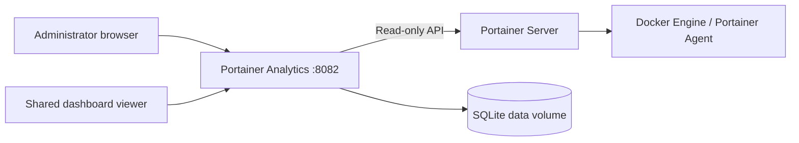

# Portainer Analytics

**A read-only operations console for Docker environments managed through Portainer.**

I built Portainer Analytics to bring environment discovery, container telemetry and configurable dashboards into one lightweight interface. It is designed for industrial edge gateways, lab systems and small Docker installations where I want useful operational data without deploying a full monitoring stack.

[](https://github.com/pablonietopareja/portainer-analytics/actions/workflows/ci.yml)


[](LICENSE)

> **Independent project.** Portainer Analytics uses the Portainer API; it is not an official Portainer product or affiliated with Portainer.

## The console at a glance


*Live environment overview: container inventory, CPU, memory, network traffic, resource history and Docker storage.*

### What it looks like

**Custom dashboards** — combine live and historical metrics in configurable panels, choose time ranges and refresh rates, and share selected dashboards through revocable read-only links.


**Container inventory** — review workloads, health and lifecycle state alongside per-container CPU, RAM and network measurements.


**Administrator access** — a first-use setup creates the workspace and administrator credentials. Subsequent configuration and dashboard management require sign-in.


These images show the application running against a Portainer-managed environment. Values are point-in-time examples, not benchmark results or promises of universal metric availability. The displayed browser address belongs to a private LAN and is not a public demo endpoint.

## What I built

- **Environment overview:** discovered Docker environments, live counts, workload health, CPU and memory consumption, network traffic and Docker storage.
- **Resource inventory:** containers, stacks, images, networks, volumes, activity and system information. Optional Swarm and Portainer Agent capabilities are shown when the API exposes them.
- **Metrics:** normalized CPU, memory, network, block I/O, lifecycle and storage measurements, with additional numeric Docker counters available through bounded discovery. Unavailable values are not presented as zero.
- **Custom dashboards:** time-series charts, metric cards, gauges, bar comparisons and tables; panel editing, reordering, multiple sources, saved configurations and up to 24 hours of selected-metric history.
- **Controlled access:** local administrator authentication, session and CSRF protection, private persistence, and revocable read-only dashboard links.
- **Deployment:** Python or a non-root Docker container with a read-only root filesystem, dedicated data volume and built-in healthcheck. No Docker socket mount is required.

The console only reads Portainer/Docker data. It cannot start, stop, create, delete or modify Docker resources. Application configuration, dashboards and share links are written to its own SQLite database.

## Architecture



The application consists of five Python runtime modules and a local HTML/CSS/JavaScript frontend. It has no CDN dependency, runtime Node.js dependency or third-party UI bundle. Its API client talks to the **Portainer server**, not directly to an Agent address.

## Requirements and compatibility

| Component | Requirement |
| --- | --- |
| Python | Python 3.14; locked production dependencies |
| Docker | Linux Docker Engine with Compose v2 when deploying as a container |
| Architecture | AMD64 and ARM64 container builds and isolated acceptance checks pass in CI |
| Portainer | A reachable Portainer server API and a token authorized for the target Docker environments |
| Browser | Modern JavaScript-capable browser; automated end-to-end coverage uses Chromium |
| Development tools | Node.js for frontend tests only, not for running the console |

GitHub Actions has passed its Windows/Linux test jobs and Docker acceptance jobs on AMD64 and ARM64. Those jobs exercise synthetic Portainer responses and isolated containers. They do **not** certify every live Portainer/Agent combination or perform a full container OS vulnerability scan. See [Release Audit](RELEASE_AUDIT.md).

## Quick start: Docker Compose

Clone the repository and start the service:

```sh
git clone https://github.com/pablonietopareja/portainer-analytics.git
cd portainer-analytics
docker compose config --quiet
docker compose up -d --build
docker compose ps
```

Open **http://localhost:8082** (or `http://YOUR_GATEWAY_IP:8082` from another device on your trusted network). On the first visit, create an administrator password of at least 12 characters, enter the Portainer **server** URL and API token, then select **Test connection & create workspace**.

Use the same Docker volume across upgrades. A new volume means a new, empty workspace. Avoid exposing first-use setup to an untrusted network.

### Run directly with Python

On Windows PowerShell, from the repository root:

```powershell
python -m venv .venv
.\.venv\Scripts\python.exe -m pip install --require-hashes -r requirements.txt
.\.venv\Scripts\python.exe portainer_console.py
```

On Linux, with Python 3.14 available:

```sh
python3.14 -m venv .venv
.venv/bin/python -m pip install --require-hashes -r requirements.txt
.venv/bin/python portainer_console.py
```

The local server binds to `127.0.0.1:8082` by default. Add `--host 0.0.0.0` if you deliberately need LAN access. Stop the process with `Ctrl+C`.

### Deploy using the Portainer interface

Portainer can build the supplied source context without requiring a remote image registry:

1. Run `python scripts/build_release.py` to produce the Docker build-context tar.
2. In Portainer, select the target Docker environment and open **Images > Build a new image > Upload**.
3. Upload `dist/portainer-analytics-alpha-3-build-context.tar`; set image name `portainer-analytics:alpha-3` and Dockerfile path `Dockerfile`.
4. In the **same environment**, create a stack from `portainer-stack.yml` with image re-pulling disabled.
5. Open port `8082` and complete the first-use setup.

The tar is a **build context**, not an image archive for **Images > Import**. For exact steps, troubleshooting and upgrade precautions, read [Deployment](docs/DEPLOYMENT.md).

## Configuration and persistence

| Setting | Description | Default |
| --- | --- | --- |
| `CONSOLE_HOST` | Listening address; `--host` takes precedence | `127.0.0.1` locally; `0.0.0.0` in Docker |
| `CONSOLE_PORT` | HTTP port; `--port` takes precedence | `8082` |
| `CONSOLE_DATA_DIR` | Persistent database directory | Local `data/`; `/data` in Docker |
| `CONSOLE_PUBLIC_URL` | Public origin for dashboard links and HTTPS cookie behavior | Browser origin |
| `CONSOLE_ALLOWED_HOSTS` | Additional allowed DNS hostnames | None |
| `--interval` | Target container statistics sampling interval | 5 seconds (minimum 2) |

Container inventory refresh targets about 30 seconds; storage and optional Agent information about 60 seconds. API response times may affect observed refresh intervals. The SQLite database holds configuration, password hashes, dashboards, shares and a rolling 24-hour history for selected metrics. **Portainer API tokens are not encrypted by the application.** Protect its storage volume and backups.

For remote access, use a reverse proxy with HTTPS and access controls. Set `CONSOLE_PUBLIC_URL` to the actual HTTPS origin; the built-in HTTP server does not terminate TLS. Avoid committing credentials to files or passing them in Docker build arguments.

## Development and verification

```sh
python -m pip install --require-hashes -r requirements-dev.txt
npm ci --ignore-scripts
npm run browser:install
python -m ruff check .
python -m ruff format --check .
python -m unittest discover -s tests -v
npm run check
npm test
npm run test:browser
python scripts/verify_release.py
python scripts/build_release.py
```

The browser tests use temporary local services and synthetic Portainer responses. The current CI workflow runs the source checks on Linux and Windows and isolated Docker acceptance on both AMD64 and ARM64. There is no automatic publishing job. Review the [test and release record](RELEASE_AUDIT.md) and [contribution guidelines](CONTRIBUTING.md) before making changes.

## Limitations

- Docker is the primary supported data model. Kubernetes, Podman and asynchronous Edge environments are not treated as equivalent Docker APIs.
- Host-wide CPU/RAM metrics outside Docker, GPU usage, CPU temperature and arbitrary application telemetry require additional exporters or APIs.
- Up to 64 panels per dashboard and 16 sources per panel are accepted; history is limited to 24 hours.
- Swarm, optional Agent data and some memory/IO counters depend on Docker versions, runtime capabilities and permissions.
- Shared dashboard URLs are bearer links: anyone who receives an active link can see that dashboard's selected data. Revoke links when no longer required.
- This is an alpha application intended for controlled deployments, not a drop-in public Internet monitoring service.

For metric definitions and caveats, see [METRICS.md](METRICS.md). Security guidance is in [SECURITY.md](SECURITY.md).

## Project documentation

| Document | Purpose |
| --- | --- |
| [Release audit](RELEASE_AUDIT.md) | Executed CI checks, local review and outstanding validation |
| [Deployment guide](docs/DEPLOYMENT.md) | Docker, Portainer, security and upgrade instructions |
| [Metric reference](METRICS.md) | Measurements, units and collection boundaries |
| [Changelog](CHANGELOG.md) | Version history and changes |
| [Contributing](CONTRIBUTING.md) | Development workflow and test commands |
| [Security](SECURITY.md) | Vulnerability reporting and deployment safeguards |
| [Licensing](docs/LICENSING.md) | MIT application licensing and third-party obligations |
| [Third-party notices](THIRD_PARTY_NOTICES.md) | Dependency attribution and notices |

**License:** [MIT](LICENSE). I maintain this as an independent open-source project; Portainer and other third-party names remain the property of their respective owners.
