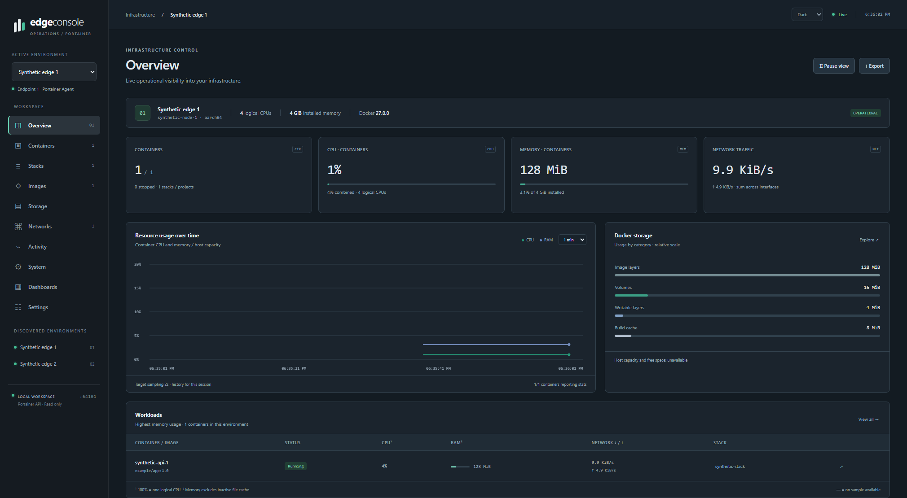
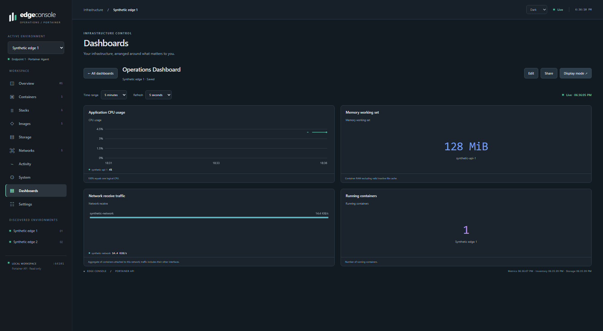
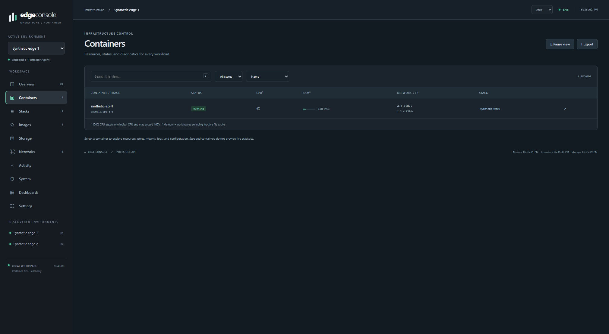
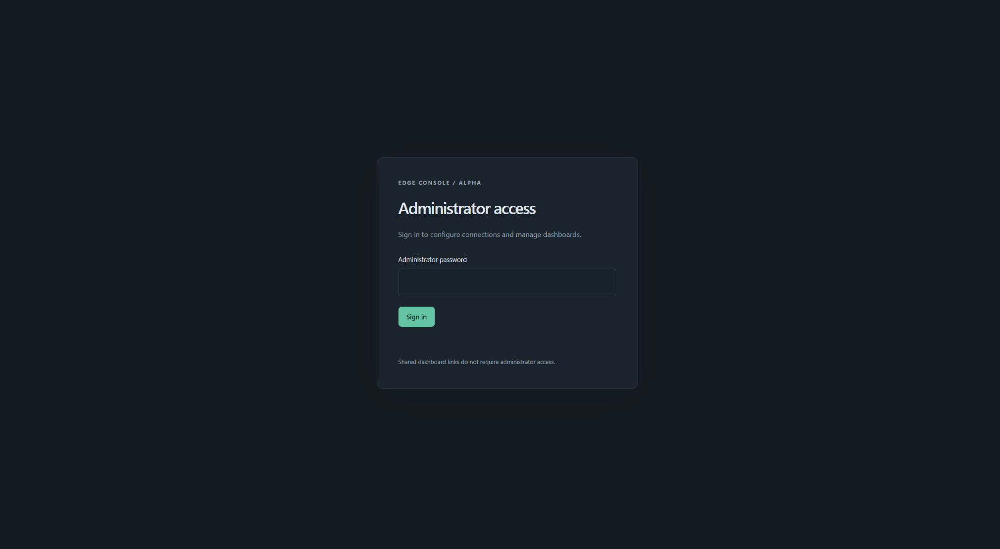
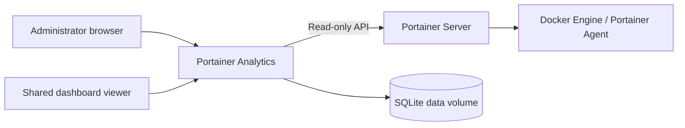

# Portainer Analytics

**Read-only Docker inventory, telemetry and dashboards through the Portainer Server API.**

Portainer Analytics brings environment discovery, container metrics and configurable dashboards into one lightweight application. It is intended for edge gateways, labs and small Docker installations. **Portainer Analytics** is the project name; **Edge Console** is the interface branding.

[](https://github.com/pablonietopareja/portainer-analytics/actions/workflows/ci.yml)

[](LICENSE)

> Independent project. Portainer Analytics uses the Portainer API; it is not an official Portainer product and is not affiliated with Portainer.

## The console at a glance



*Environment overview: inventory, container CPU and memory, network traffic, recent history and Docker storage.*

**Custom dashboards** combine charts, metric cards, gauges, comparisons and tables. Save layouts, choose time ranges and refresh rates, and share selected dashboards through revocable read-only links.



**Container inventory** shows workloads, health and lifecycle state alongside available per-container telemetry.



**Administrator access** protects configuration and dashboard management. First-use setup creates the workspace and administrator credentials.



These screenshots are captured from the application using synthetic test data. Their values illustrate the interface; they are not benchmarks or evidence of compatibility with a particular production deployment.

## Features and boundaries

- Environment, container, stack, image, network and volume inventory, plus activity and system information.
- Normalized CPU, memory, network, block I/O, lifecycle and storage measurements; bounded discovery of additional numeric Docker counters.
- Dashboard editing, panel reordering, multiple sources per panel and up to 24 hours of selected-metric history.
- Local administrator authentication, session and CSRF protection, persistent configuration and revocable dashboard sharing.
- Python deployment or a non-root Docker container with a read-only root filesystem, persistent data volume and healthcheck.

The console only queries the Portainer **Server API**. It cannot start, stop, create, delete or modify managed Docker resources, and it does not require a Docker socket mount. It writes its own configuration, dashboards, share links and history to SQLite. Optional Swarm and Portainer Agent information appears only when available through the server API; this does not imply that the supplied deployment stack supports Swarm.



The runtime uses five Python modules and local HTML, CSS and JavaScript. There is no runtime Node.js requirement, CDN dependency or third-party UI bundle.

## Requirements and compatibility

| Component | Requirement |
| --- | --- |
| Python | Python 3.14 with locked production dependencies |
| Containers | Linux Docker Engine and Compose v2; the supplied Portainer stack targets Docker Standalone |
| Portainer | Reachable Portainer Server API and a token authorized to read the target Docker environments |
| Browser | Modern JavaScript-capable browser; automated browser coverage uses Chromium |
| Development | Node.js matching `package.json` for frontend tests only |

The published `v1.0.0` revision, `724531289db31d5e37bc3aa4baaf1114bd074c93`, passed Ubuntu and Windows source checks and native Linux AMD64/ARM64 container acceptance in [CI run 38521810456](https://github.com/pablonietopareja/portainer-analytics/actions/runs/38521810456) and [CI run 38525747883](https://github.com/pablonietopareja/portainer-analytics/actions/runs/38525747883), including the corrected Windows packaging tests. Synthetic tests do not establish compatibility with every Portainer Server, Agent or Edge configuration or replace a full built-image OS vulnerability scan. See the revision-specific [verification record](RELEASE_AUDIT.md).

## Quick start: Docker Compose

The following commands use `main`. For the immutable `v1.0.0` source checkout, use `git clone --branch v1.0.0 --depth 1 https://github.com/pablonietopareja/portainer-analytics.git` as the first command.

```sh
git clone https://github.com/pablonietopareja/portainer-analytics.git
cd portainer-analytics
docker compose config --quiet
docker compose up -d --build
docker compose ps
```

Open **http://localhost:8082 on the Docker host**. The supplied Compose file publishes only on host loopback by default. On the first visit, create an administrator password of at least 12 characters, enter the Portainer **Server** URL and API token, then select **Test connection & create workspace**. Complete setup before enabling access from other devices.

Use Docker Engine 28.0.0 or newer for localhost publication isolation and review custom network routing. Older releases have a documented same-network exposure caveat; see [Deployment](docs/DEPLOYMENT.md).

For deliberate LAN access, set `CONSOLE_BIND_ADDRESS` to the host's trusted LAN address in a local `.env` file and recreate the service. Use `0.0.0.0` only when firewall rules and access controls restrict all exposed interfaces. This setting changes the host port mapping, not the container listener. Reverse proxies in separate containers must reach the application through a shared Docker network. See [Deployment](docs/DEPLOYMENT.md) for remote setup, HTTPS and upgrade instructions.

Keep the original data volume across upgrades. A new volume creates an empty workspace. The 1.0.0 manifests tighten the default host binding to loopback; existing LAN deployments must review the port mapping before updating.

### Run directly with Python

From the repository root, on Windows PowerShell:

```powershell
python -m venv .venv
.\.venv\Scripts\python.exe -m pip install --require-hashes -r requirements.txt
.\.venv\Scripts\python.exe portainer_console.py
```

On Linux with Python 3.14:

```sh
python3.14 -m venv .venv
.venv/bin/python -m pip install --require-hashes -r requirements.txt
.venv/bin/python portainer_console.py
```

The server binds to `127.0.0.1:8082` by default. Use `--host` and `--port` to change the listener deliberately. Stop it with `Ctrl+C`.

### Build and deploy through Portainer

1. Run `python scripts/build_release.py` to create the Docker build-context tar.
2. In a Docker Standalone environment, open **Images > Build a new image > Upload**.
3. Upload `dist/portainer-analytics-1.0.0-build-context.tar`, with image tag `portainer-analytics:1.0.0` and Dockerfile path `Dockerfile`.
4. In the **same environment**, create a stack from `portainer-stack.yml` with image re-pulling disabled.
5. Access host loopback locally or through an SSH tunnel and complete setup. Deliberately edit the stack's published address when LAN access is required.

The tar is a **build context**, not an image archive for **Images > Import**. Full instructions are in [Deployment](docs/DEPLOYMENT.md).

## Configuration and persistence

| Setting | Purpose | Default |
| --- | --- | --- |
| `CONSOLE_HOST` | Application listener; `--host` takes precedence | `127.0.0.1` locally, `0.0.0.0` inside Docker |
| `CONSOLE_PORT` | Application HTTP port; `--port` takes precedence | `8082` |
| `CONSOLE_BIND_ADDRESS` | Compose host-side published address | `127.0.0.1` |
| `CONSOLE_DATA_DIR` | SQLite directory | Local `data/`, `/data` in Docker |
| `CONSOLE_PUBLIC_URL` | External origin for dashboard links and HTTPS cookie policy | Browser origin for links; Secure cookies require an HTTPS setting |
| `CONSOLE_ALLOWED_HOSTS` | Additional accepted DNS names in HTTP Host headers | None; localhost and private/loopback IP addresses are accepted |
| `--interval` | Target container-statistics sampling interval | 5 seconds, minimum 2 |

Inventory refresh targets about 30 seconds; storage and optional Agent information about 60 seconds. Upstream latency affects actual collection. Dashboard refresh intervals of 5, 10, 30 or 60 seconds control display updates separately from backend sampling. Selected metrics are retained in SQLite for a rolling 24 hours; unsupported or missing values remain unavailable, rather than becoming zero.

**Portainer API tokens are stored without application-level encryption.** Protect the data directory, volume and backups. Use a dedicated token with the least permissions available. For remote access, use HTTPS through a reverse proxy, preserve Host and set `CONSOLE_PUBLIC_URL` to the actual external HTTPS origin. The built-in server does not terminate TLS. Active shared dashboard URLs are bearer credentials: anyone receiving one can view its selected data until it is revoked.

## Development and verification

```sh
python -m pip install --require-hashes -r requirements-dev.txt
npm ci --ignore-scripts
npm run browser:install
python -m ruff check .
python -m ruff format --check .
python -m unittest discover -s tests -v
npm run check
npm test
npm run test:browser
python scripts/verify_release.py
python scripts/build_release.py
```

Tests use isolated local services and synthetic Portainer responses. The workflow checks and builds; it does not publish images or create releases. See [Contributing](CONTRIBUTING.md) for security scans and container acceptance.

## Limitations

- Docker is the primary data model. Kubernetes, Podman and asynchronous Edge environments are not treated as equivalent Docker APIs.
- Host CPU/RAM outside containers, GPU usage, temperature and arbitrary application telemetry require additional exporters or APIs.
- Dashboards accept up to 64 panels and 16 sources per panel. History is limited to 24 hours.
- Swarm data, optional Agent information and some memory/I/O counters depend on API versions, capabilities and permissions.
- Pattern-based redaction cannot guarantee that upstream logs, labels or errors contain no sensitive data.

## Documentation

| Document | Purpose |
| --- | --- |
| [Deployment](docs/DEPLOYMENT.md) | Docker, Portainer, network access and upgrades |
| [Metrics](METRICS.md) | Units, collection and interpretation |
| [Security](SECURITY.md) | Vulnerability reporting and safeguards |
| [Release verification](RELEASE_AUDIT.md) | Completed checks, evidence and outstanding validation |
| [Changelog](CHANGELOG.md) | Version changes |
| [Contributing](CONTRIBUTING.md) | Development and verification |
| [Licensing](docs/LICENSING.md) | Application license and redistribution obligations |
| [Third-party notices](THIRD_PARTY_NOTICES.md) | Dependency attribution |

**License:** [MIT](LICENSE). Portainer and other third-party names remain the property of their respective owners.
