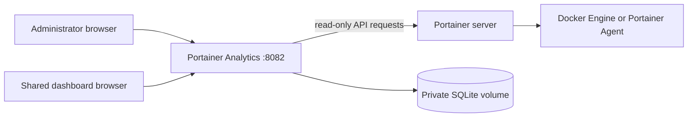

# Portainer Analytics

Portainer Analytics is a read-only monitoring console for Docker environments
managed by Portainer. It combines container inventory, resource measurements and
saved dashboards for operators working on a local network or an edge gateway.
It is an independent project, not an official Portainer product.

**Alpha source release: `alpha.3`.** Approved by the maintainer for publication.
See [RELEASE_AUDIT.md](RELEASE_AUDIT.md) for executed checks and their limits. Docker
image execution and integration with a real Portainer server have not been verified
for this version.



## Features

- Environment navigation with containers, stacks, images, volumes, networks and
  Docker storage. Swarm services, nodes and Agent hardware appear when available.
- CPU, memory, network, block I/O, lifecycle and storage measurements, plus bounded
  discovery of native numeric Docker stats. Missing measurements stay unavailable.
- Drag-and-drop dashboards with time series, values, gauges, bar comparisons and
  tables; multiple resource selections, panel editing, reorder and undo/redo.
- Saved dashboard names, edits, deletion, persistent selected-metric history for
  up to 24 hours, and revocable read-only dashboard URLs.
- English interface, light/dark/system themes and fullscreen displays.
- First-use connection setup, administrator login and server-side token storage.

The application does not start, stop, delete or change Docker resources. It is not
a host exporter or a long-term metrics database. See [METRICS.md](METRICS.md) for
units, aggregation rules, available APIs and collection limits.

## Requirements

| Component | Requirement and verification scope |
| --- | --- |
| Python | 3.14; tested with 3.14.6 on Windows x64. Runtime packages are hash-locked. |
| Portainer | A reachable server API, a token and access to Docker environments. The application uses the Docker proxy API; this candidate was tested with synthetic API fixtures, not a live Portainer installation. |
| Browser | A modern browser with JavaScript and canvas. Automated browser checks use Chromium through Playwright; other engines are not qualified. |
| Docker, optional | Linux Docker Engine and Compose v2. AMD64 and ARM64 are intended image targets; this candidate's container execution is not verified. Raspberry Pi requires a 64-bit OS. |
| Node.js, development only | Node 24.18.0 was used for the JavaScript checks. Node is not needed to run the application. |

The selected Portainer server must be reachable **from the application**, which
may run on a different machine from your browser. A Portainer Agent address is
not a substitute for the Portainer server API address.

## Quick start: Python

Run from the repository root with Python 3.14. On Windows PowerShell:

```powershell
python -m venv .venv
.\.venv\Scripts\python.exe -m pip install --require-hashes -r requirements.txt
.\.venv\Scripts\python.exe portainer_console.py
```

On Linux or macOS (these shell commands were not executed on those platforms):

```sh
python3.14 -m venv .venv
.venv/bin/python -m pip install --require-hashes -r requirements.txt
.venv/bin/python portainer_console.py
```

Open **http://localhost:8082**. Create an administrator password of at least
12 characters, enter the Portainer server URL and API token, and select
**Test connection & create workspace**. Failed validation saves nothing. A new
installation contains no connection, account or dashboards. Stop with **Ctrl+C**.

For access from another computer, add `--host 0.0.0.0` when starting the server.
Complete initial setup on a controlled network before allowing other users to
reach the service. Use HTTPS through a reverse proxy outside a trusted local
network; the Python server does not terminate TLS itself.

## Configuration and storage

Connection settings are entered in the web interface, tested before saving, and
stored in SQLite. Subsequent starts use those saved settings. A changed Portainer
URL requires a new token. A blank token retains the saved token only for the same
URL. TLS verification is enabled by default. For a private certificate authority,
install its CA in the runtime trust store instead of disabling verification.

| Variable | Purpose | Required | Safe example/default |
| --- | --- | --- | --- |
| `CONSOLE_HOST` | HTTP bind address; `--host` overrides it | No | `127.0.0.1` locally; Docker uses `0.0.0.0` |
| `CONSOLE_PORT` | HTTP listener; `--port` overrides it | No | `8082` |
| `CONSOLE_DATA_DIR` | Private writable data directory; `--data-dir` overrides it | No | `data` beside the source; Docker uses `/data` |
| `CONSOLE_PUBLIC_URL` | External origin for shared links and HTTPS cookie mode | No | `https://analytics.example.com` |
| `CONSOLE_ALLOWED_HOSTS` | Additional comma-separated DNS hostnames | No | `analytics.example.com` |

`--interval` controls stats refresh in seconds (default 5, minimum 2). Inventory
refreshes approximately every 30 seconds, and storage/Agent capabilities every
60 seconds. Slow or unavailable upstreams can extend these intervals.

The example `.env` is read by Docker Compose for its interpolation; the Python
application does not load `.env` files. Do not put Portainer credentials in build
arguments, source files or frontend assets. There is no environment-variable
bootstrap for connection credentials or an administrator password.

Localhost, the machine's hostname and private LAN IP addresses are accepted Host
values. Configure other DNS names explicitly. For an HTTPS reverse proxy, set
`CONSOLE_PUBLIC_URL=https://analytics.example.com` and preserve the external Host
header. This enables `Secure` cookies. Forwarded identity headers are not trusted.

SQLite stores settings, password hashes, dashboard definitions, sharing tokens and
selected metric history at `console.sqlite3` in the data directory. Portainer
tokens are **not encrypted by the application**. Protect the directory and backups.
Keep the `analytics-data` named volume when replacing a container. Stop the
application before copying its database, or use SQLite's backup API.

## Docker and Portainer

Dockerfiles and deployment examples are prepared but their execution remains an
outstanding release check. Build locally with:

```sh
docker compose config --quiet
docker compose up -d --build
docker compose ps
```

The service and shared dashboards use **8082:8082**. The image runs as UID/GID
10001, has a read-only root filesystem, and writes only to its data volume and
temporary filesystem. It does not mount the Docker socket or require privileged
mode. The pinned base manifest provides AMD64 and ARM64 variants.

For deployment entirely through Portainer:

1. Run `python scripts/build_release.py` in this repository.
2. Select the target Docker environment in Portainer.
3. In **Images > Build a new image > Upload**, upload
   `dist/portainer-analytics-alpha-3-build-context.tar`, set the image name to
   **`portainer-analytics:alpha-3`**, and use `Dockerfile` as the Dockerfile path.
4. After the build succeeds, use **Stacks > Add stack > Upload** with
   `portainer-stack.yml` in the **same environment**. Keep image re-pulling disabled.
5. Open `http://GATEWAY_IP:8082` and complete setup.

The tar is a **build context**, not an image archive for **Images > Import**. The
edge needs Internet access during the build to obtain the pinned base and Python
packages. See [deployment and upgrade details](docs/DEPLOYMENT.md), including the
remaining container acceptance checks.

## Architecture and permissions

`portainer_console.py` serves the authenticated HTTP API and static interface.
`engine.py` collects read-only Portainer/Docker data with bounded HTTP timeouts and
a worker pool. `telemetry.py` normalizes native counters; `dashboard_metrics.py`
validates panel definitions and projects selected series; `persistence.py` owns
SQLite transactions and retention. The frontend uses local HTML, CSS and JavaScript
with canvas charts. It has no CDN or runtime Node dependency.

Use a dedicated Portainer account/token restricted to the environments and read
operations needed for monitoring. The application does not require an administrator
token by design; available permissions depend on Portainer edition and policy.
Denied optional APIs appear as unavailable capabilities. Application changes write
only to its own database, not to Portainer.

Administrator sessions and CSRF checks protect management routes. Public dashboard
URLs are bearer capabilities: anyone holding a link can view its selected data.
Rotate or disable a share to revoke access. The public response excludes inventory,
connection settings, inspect routes and log routes. Operational logs/labels can
still contain sensitive data; automated redaction cannot recognize every format.

Application runtime traffic goes to the configured Portainer server and browsers
using the console. No analytics service or usage telemetry is included. Installation,
dependency auditing and CI contact package registries and advisory services.

## Development and verification

Activate your virtual environment, then install locked development dependencies:

```sh
python -m pip install --require-hashes -r requirements-dev.txt
npm ci --ignore-scripts
npm run browser:install
python -m ruff check .
python -m ruff format --check .
python -m unittest discover -s tests -v
npm run check
npm test
npm run test:browser
python scripts/verify_release.py
python scripts/build_release.py
```

Use `TEST_PYTHON` to select the Python executable for browser tests if `python`
does not resolve to your virtual environment. The tests start their own application
and synthetic Portainer servers on temporary loopback ports. Their data is generated
in temporary directories; they do not use a running installation or its database.
`TEST_BROWSER_CHANNEL` can select an installed browser channel instead of the
Playwright Chromium build.

See [CONTRIBUTING.md](CONTRIBUTING.md) for lockfile updates, security scans and CI.
The workflow performs checks and container builds; it has no publishing step.

## Troubleshooting

| Symptom | Action |
| --- | --- |
| `ModuleNotFoundError: requests` | Use the same virtual environment Python for installation and startup. Run its `python -m pip install --require-hashes -r requirements.txt`. |
| Portainer reports HTTP 500 during deployment | Inspect the failed browser Network request's Response or Portainer server logs. The generic status alone does not identify the cause. |
| `No such image: portainer-analytics:alpha-3` | Check Images in the selected environment. The tag must match the stack exactly. A build named only `portainer-analytics` gets `latest`; retag it or change `image:` deliberately. |
| Port 8082 unavailable | Check for another listener or container using the port. For local Python testing, choose another `--port`. |
| `Host not allowed` | Add the DNS hostname to `CONSOLE_ALLOWED_HOSTS`, or use the machine's private LAN IP. |
| Invalid credentials / permission denied | Verify the server API URL, token and account's environment permissions. Do not use the Agent address. |
| Certificate verification fails | Configure a valid certificate/CA trust chain. Disabling verification removes server authentication. |
| Login repeats behind an HTTPS proxy | Set the correct HTTPS public URL, preserve Host and access the external HTTPS address. Secure cookies are not sent over HTTP. |
| Missing RAM, disk or service metric | Check runtime/cgroup support and optional API permissions; unavailable values are not zero. |
| Saved dashboards disappeared | Check the data volume and stack name. Recreating the application with a different volume starts an empty workspace. |

## Compatibility and limits

- Docker environments are the supported data model. Kubernetes, Podman and
  asynchronous Edge environments are not qualified by the synthetic Docker tests.
- Swarm, Windows container counters and optional Agent APIs have normalization
  tests; their live deployment compatibility is not established for this candidate.
- Up to 64 panels per dashboard and 16 sources per panel are accepted. History is
  bounded to 24 hours; this is not a fleet-scale observability backend.
- The server bounds concurrent requests and sessions, but is not hardened as a
  public Internet service. Use network access controls and an HTTPS reverse proxy.
- See [RELEASE_AUDIT.md](RELEASE_AUDIT.md) for current PASS, FAIL and NOT RUN results.

## Contributing, security and license

Read [CONTRIBUTING.md](CONTRIBUTING.md) before submitting changes and
[SECURITY.md](SECURITY.md) before reporting a vulnerability. Changes are recorded in
[CHANGELOG.md](CHANGELOG.md). Application code uses the [MIT license](LICENSE).
Dependencies retain their own terms in [THIRD_PARTY_NOTICES.md](THIRD_PARTY_NOTICES.md)
and [licensing notes](docs/LICENSING.md). Portainer's name belongs to its owner;
this project does not claim endorsement.

Maintainers preparing a repository upload should follow the
[manual publication guide](docs/PUBLISHING.md). Outstanding container acceptance
checks remain documented separately from the approved alpha source publication.
